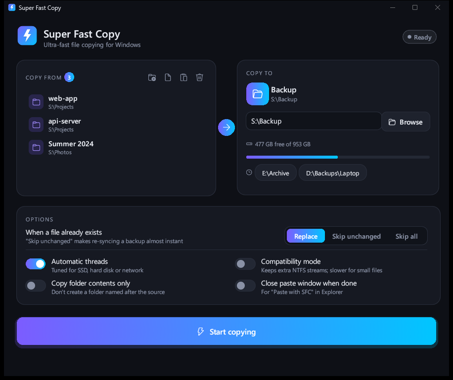
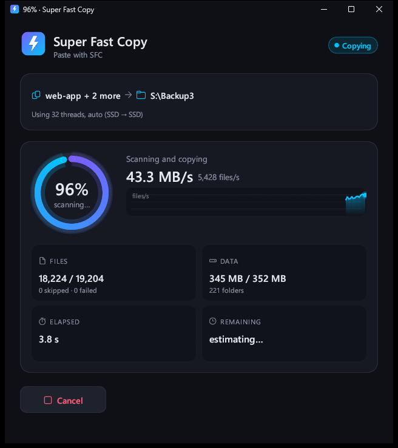
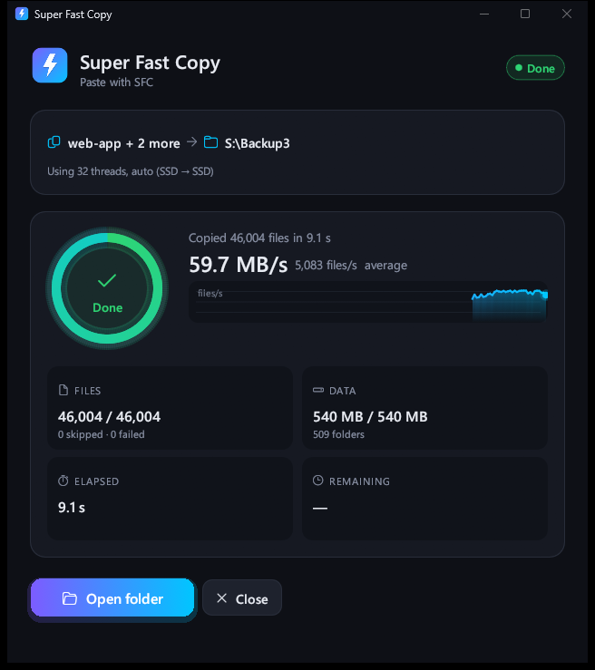
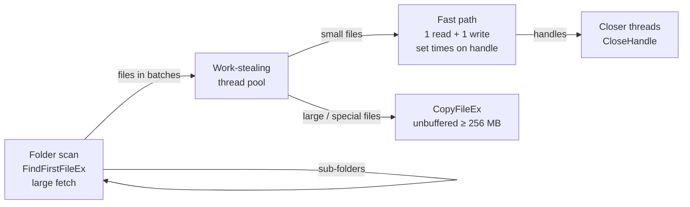

<div align="center">


# Super Fast Copy (SFC)

**Copy folders with thousands of small files on Windows several times faster than Explorer.**

[](https://github.com/boulbeba115/sfc-super-fast-copy/releases/latest)
[](https://github.com/boulbeba115/sfc-super-fast-copy/releases)
[](LICENSE)


[**Download**](https://github.com/boulbeba115/sfc-super-fast-copy/releases/latest) ·
[Features](#features) ·
[Usage](#usage) ·
[Benchmarks](#benchmarks) ·
[How it works](#how-it-works) ·
[Build from source](#build-from-source)



</div>

## Why

Explorer copies files one after another. For a folder full of small files
(source code, `node_modules`, photo libraries, game mods) most of the time
goes into opening, creating and closing each file, not into moving data, so
a 300 MB folder can take minutes.

Super Fast Copy copies many files at once, chooses the number of threads to
suit your drives, and avoids every system call it can. It adds
**Copy with SFC** / **Paste with SFC** to the right-click menu, so it fits
into the way you already copy files.

## Features

- **Parallel copy engine** in Rust. Folder scanning and copying overlap, and
  the work is spread over all cores by a work-stealing thread pool.
- **Drive-aware tuning**: detects SSD, HDD and network drives and picks the
  thread count for each (many threads for SSDs and shares, few for hard
  disks so they don't thrash).
- **Right-click copy and paste** in Explorer, with a compact progress window
  that closes itself when done. It uses the normal Windows clipboard, so
  Ctrl+C / Ctrl+V keep working alongside it.
- **Modern window** with drag-and-drop, a live speed graph, progress ring,
  time remaining, free space on the destination drive and recent destinations.
- **Fast re-sync**: *Skip unchanged* compares size and date against one
  listing of each destination folder. Re-checking 30,000 unchanged files
  takes about 0.2 s.
- **Command-line tool** (`superfastcopy`) for scripts and scheduled backups.
- **Keeps timestamps and attributes**, handles paths longer than 260
  characters, and overwrites read-only and hidden files.
- **Small and dependency-free**: two native executables and a 4 MB installer,
  with no runtime to install.

<table>
  <tr>
    <td align="center"><br><sub>Paste with SFC: copying</sub></td>
    <td align="center"><br><sub>46,004 files done in 9.1 s</sub></td>
  </tr>
</table>

<sub>Screenshots taken with the installer's Defender option enabled (see below), copying between folders on an NVMe SSD.</sub>

## Download and install

1. Download **`SuperFastCopy-Setup-x.y.z.exe`** from the
   [latest release](https://github.com/boulbeba115/sfc-super-fast-copy/releases/latest).
2. Run it. Windows SmartScreen may show *"Windows protected your PC"*
   because the installer isn't code-signed: click **More info → Run anyway**.
3. Pick the options you want:

| Installer option | Default | What it does |
|---|:---:|---|
| Right-click menu entries | ✅ | Adds **Copy with SFC**, **Paste with SFC** and **SFC: copy to folder...** |
| Send to menu | ✅ | Adds Super Fast Copy to *Send to* |
| Add to PATH | ✅ | Lets you run `superfastcopy` from any terminal |
| Desktop shortcut | ⬜ | |
| Full right-click menu (Windows 11) | ⬜ | Shows the classic menu so the SFC entries appear without *Show more options*. Affects every app, and restarts Explorer. |
| Microsoft Defender exclusion | ⬜ | **The biggest speed-up**, see below |

Requires Windows 10 or 11, 64-bit. Uninstall from *Settings → Apps*;
everything the installer added is removed.

### ⚡ Microsoft Defender and speed

Defender inspects every file written by programs it doesn't recognize.
Super Fast Copy is a new, unsigned program, so Defender examines each copied
file in depth and caps the speed at about 1,000–1,500 files per second no
matter how fast your disk is. robocopy and Explorer are Microsoft-signed
and get a lighter check.

| 30,004 files (449 MB), NVMe → SATA SSD | Time |
|---|---:|
| SFC without the exclusion | 21.8 s |
| SFC **with** the exclusion | **2.4 s** |

The installer's Defender option adds a *process exclusion* for the two SFC
executables. Files are then not scanned **while SFC writes them**; Defender
still scans them when they are opened or run later, and every other program
is scanned as usual. Only enable it if you're comfortable with that, the
same way you would be copying those files with any other tool.

To add or remove the exclusion manually (PowerShell as administrator):

```powershell
$dir = "C:\Program Files\SuperFastCopy"
Add-MpPreference    -ExclusionProcess "$dir\superfastcopy.exe", "$dir\superfastcopy-gui.exe"
Remove-MpPreference -ExclusionProcess "$dir\superfastcopy.exe", "$dir\superfastcopy-gui.exe"
```

## Usage

### From Explorer

1. Select files and folders → right-click → **Copy with SFC**.
2. Open the destination → right-click empty space → **Paste with SFC**
   (or right-click a folder → *Paste into this folder with SFC*).

The progress window starts copying immediately and closes itself 2.5 s after
a clean finish. You can turn that off in the main window's options.
**Paste with SFC** also pastes files copied with Ctrl+C, and Ctrl+V works
after **Copy with SFC**. Files you *cut* (Ctrl+X) are copied; the originals
are left in place.

On Windows 11 the entries are under **Show more options** unless you chose
the installer's full-menu option.

### The window

Start **Super Fast Copy** from the Start menu, drop files or folders onto it,
choose a destination and press **Start copying**. Your options and recent
destinations are remembered.

### Command line

```text
superfastcopy [OPTIONS] <SOURCE>... <DEST>
```

Each source (file or folder) is copied **into** `DEST`:

```powershell
superfastcopy C:\Photos D:\Backup                  # -> D:\Backup\Photos
superfastcopy C:\Photos C:\Music D:\Backup         # both folders into D:\Backup
superfastcopy -c C:\Photos D:\Backup\Photos        # contents only (like robocopy)
superfastcopy -e skip-same C:\Projects E:\Backup   # incremental: new and changed files only
```

| Option | Description |
|---|---|
| `-e, --existing <MODE>` | Files that already exist: `overwrite` (default), `skip-same` (same size and date), `skip` |
| `-c, --contents` | Copy a folder's contents into `DEST` instead of a sub-folder |
| `-t, --threads <N>` | Worker threads; `0` = automatic (default) |
| `--native` | Use Windows' `CopyFileEx` for every file (keeps alternate data streams) |
| `--large <MiB>` | Files at least this large use the large-file path (default 8) |
| `-q, --quiet` | Print only the summary |

Exit codes: `0` success, `1` some files failed, `2` could not start, `130`
cancelled with Ctrl+C.

## Benchmarks

Ryzen 7 2700X (16 threads), source on an NVMe SSD, Windows 11, Defender
real-time protection on (exclusion enabled for SFC). robocopy used
`/E /MT:32`. Each run wrote to a new, empty folder.

| Destination | Data | SFC | robocopy /MT:32 |
|---|---|---:|---:|
| SATA SSD | 30,004 files, 449 MB | **2.4 s** | 4.1 s |
| SATA SSD | 15,000 text files, 86 MB | **1.9 s** | 2.0 s |
| Hard disk | 15,000 text files, 86 MB | **5.0 s** | 13.4 s |

Single-threaded copies (PowerShell `Copy-Item`, plain robocopy, similar to
Explorer) took about **24 s** for the 449 MB set to the SSD.

Results depend heavily on the drives, antivirus and file sizes. SMR hard
disks in particular slow down sharply during long runs of small writes.

## How it works



- **One listing per folder.** `FindFirstFileEx` with large fetch and no 8.3
  names returns size, times and attributes for every entry, so no file is
  examined twice.
- **Scan and copy at the same time.** Copying starts on the first folder
  while the rest are still being listed.
- **Small-file fast path.** Open, one read into a reused per-thread buffer,
  one write, then timestamps and attributes set on the open handle: about
  half the system calls of `CopyFileEx`.
- **Closing on separate threads.** Antivirus and other filter drivers do
  their work when a new file is closed, so dedicated threads close handles
  while copy threads move on.
- **Large files** (8 MB and up) go through `CopyFileEx`, which overlaps reads
  and writes; files of 256 MB and up bypass the file cache. On hard disks
  large files are copied one at a time.
- **Drive detection** asks Windows whether each drive has a seek penalty
  (`IOCTL_STORAGE_QUERY_PROPERTY`), and also handles network shares and
  `subst` drives.

## Limitations

- The small-file path copies data, timestamps and attributes, but **not**
  NTFS permissions (ACLs) or alternate data streams, including the
  "downloaded from the internet" mark. Turn on **Compatibility mode**
  (`--native`) to keep streams. Large, sparse, compressed, encrypted and
  cloud-placeholder files always go through `CopyFileEx`.
- Folder junctions and symbolic links are not followed; they're counted and
  reported.
- Copy only: there's no move or mirror (delete extra files) mode yet.
- "Copy with SFC" starts one short process per selected item, because that's
  how Explorer runs menu commands. For thousands of selected items, Ctrl+C
  followed by **Paste with SFC** is quicker.

## Build from source

Requirements: Windows 10/11 x64,
[Rust](https://rustup.rs/) with the `x86_64-pc-windows-gnu` toolchain,
[WinLibs MinGW](https://winlibs.com/) (only for `dlltool`/`windres`) and
[Inno Setup 6](https://jrsoftware.org/isinfo.php) for the installer.

```powershell
winget install Rustlang.Rustup JRSoftware.InnoSetup BrechtSanders.WinLibs.POSIX.UCRT
rustup default stable-x86_64-pc-windows-gnu

git clone https://github.com/boulbeba115/sfc-super-fast-copy.git
cd sfc-super-fast-copy
.\build.ps1          # -> target\release\*.exe and dist\SuperFastCopy-Setup-<version>.exe
```

Rust links with its own bundled MinGW (see `.cargo/config.toml`). WinLibs
only provides `dlltool` and `windres`. `.cargo/gnu-libs` holds one Windows
import library (`libshlwapi.a`, from mingw-w64) that the bundled toolchain
lacks. With Visual Studio Build Tools installed, `cargo build --release` on
the MSVC toolchain works too.

### Project layout

```text
src/
  lib.rs                    copy engine: scanning, batching, skip logic, stats
  win.rs                    Win32 file APIs: enumeration, fast path, CopyFileEx, closer pool
  tune.rs                   SSD / HDD / network detection and thread count
  shell.rs                  clipboard and Explorer integration, title bar styling
  bin/superfastcopy.rs      command-line tool
  bin/superfastcopy-gui/    window (egui): main.rs, theme.rs, widgets.rs, settings.rs
installer/superfastcopy.iss Inno Setup script (menu entries, PATH, Defender option)
tools/make-icon.ps1         draws the app icon into assets/
```

## Contributing

Bug reports and pull requests are welcome. Please include your Windows
version, the drive types involved and, for speed issues, the
`superfastcopy` summary line.

## License

[MIT](LICENSE) © 2026 boulbeba115
